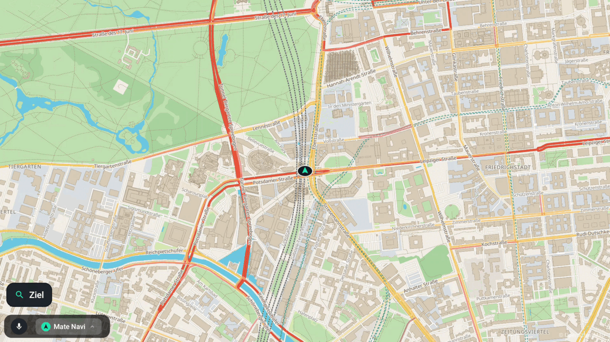
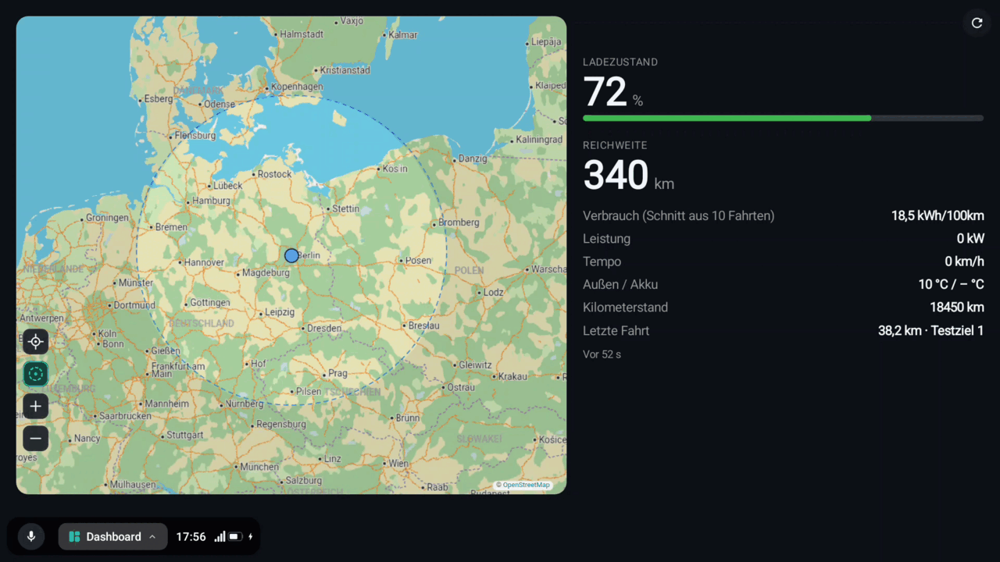
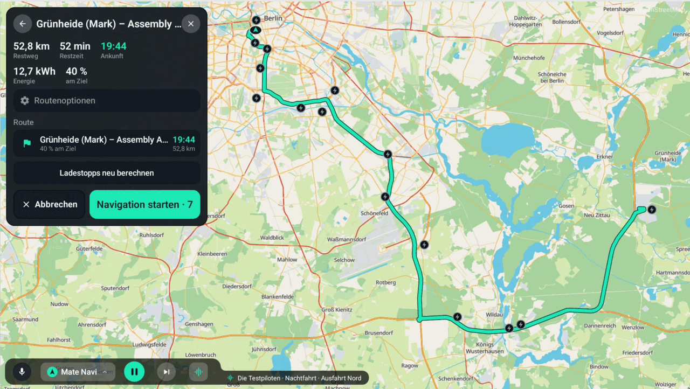
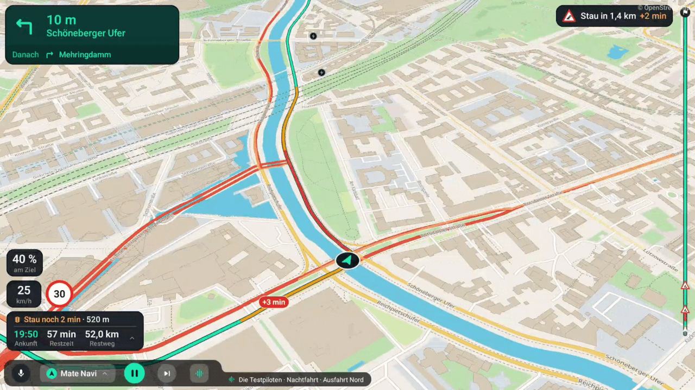
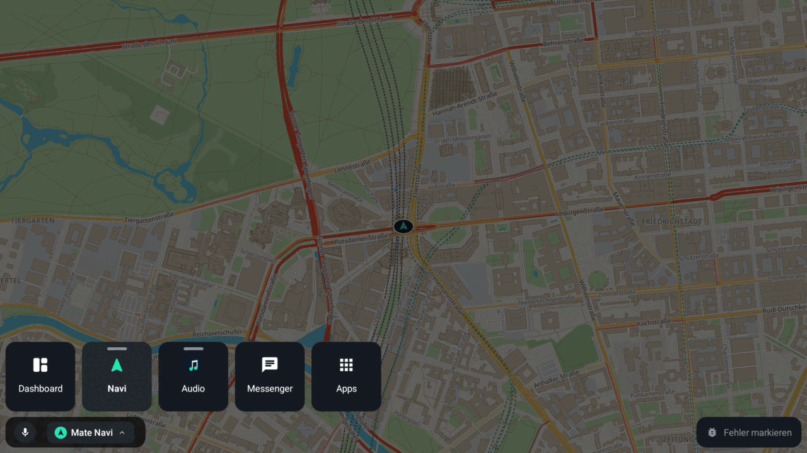
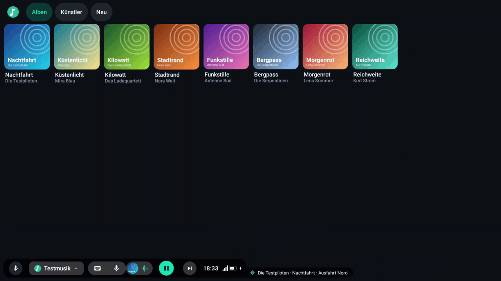
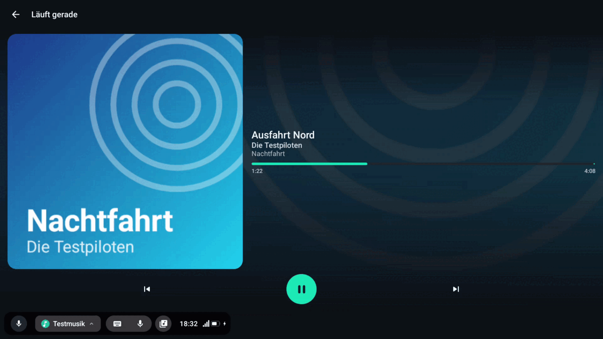
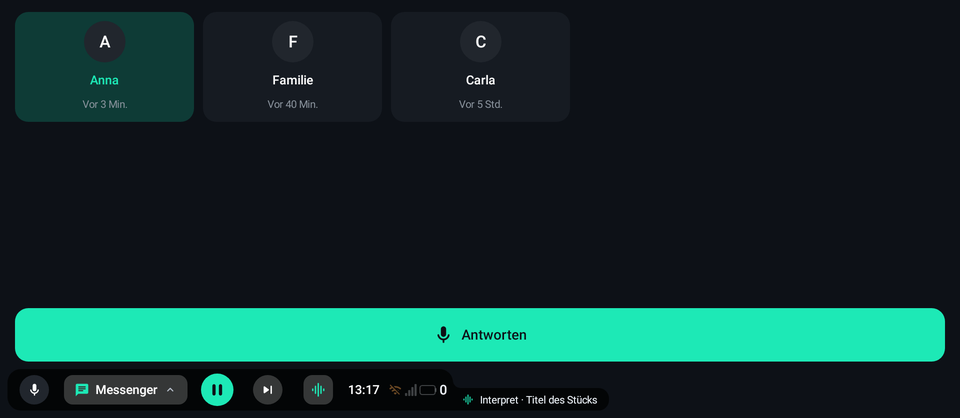
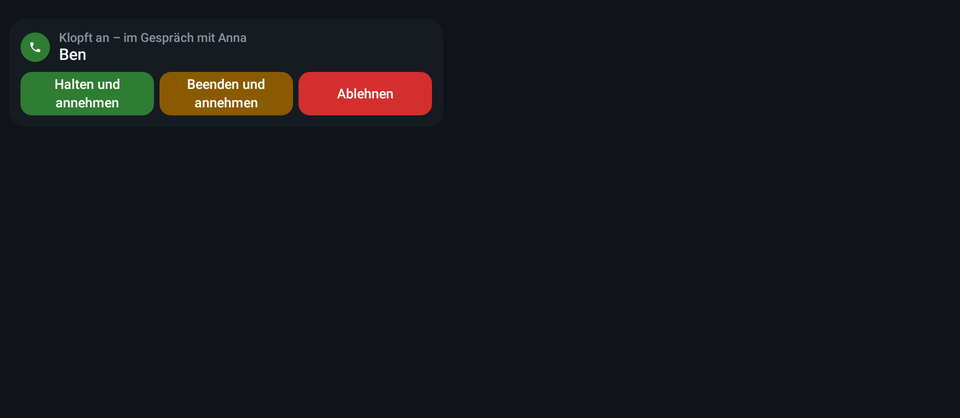
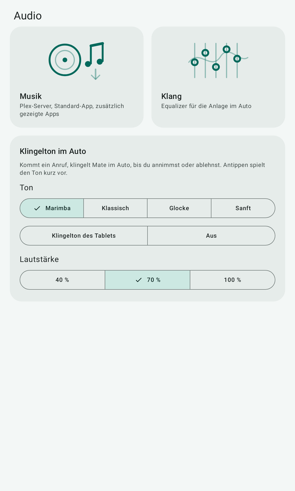

# Mate

> **Mate is a fork of [AARE](https://github.com/prototux/AARE)** by prototux and its contributors, licensed like
> AARE under the GPL-3.0-or-later. It is a separate, private project: not made, endorsed or supported by the AARE
> project. Problems with Mate belong here, not to AARE.
>
> **Mate ist ein Fork von [AARE](https://github.com/prototux/AARE)** und steht wie AARE unter der GPL-3.0-or-later.
> Ein eigenes, privates Projekt – nicht vom AARE-Projekt gemacht, unterstützt oder betreut.

Mate is a car interface for an Android tablet that sits in the car and projects onto the head unit.
It is built on AARE's open-source Android Auto stack; everything on the car screen - the bar, the
areas, the navigation, the dashboard, music, messages, calls and the cinema - is Mate's own.

> [!WARNING]
> Mate is built for one setup: an Android tablet in an electric car (tested with a Samsung Galaxy Tab S6 Lite) and a
> self-hosted map server. Other setups are not tested. Don't depend on it while driving
> until you have tried it in yours.

## Screenshots

The pictures show test data only: no real places, positions or vehicle data. Mate Navi runs on a simulated
position (the test start in Berlin, a test trip to Grünheide), the dashboard reads a test vehicle from an IDmate test instance - the range
and its ring are IDmate's own calculation from made-up trips. The ring is a plain circle only because the test
instance runs without a route server: in real use IDmate works out the area the car can reach along the roads
(with Valhalla) and shows that area instead. The other pictures
are drawn from the app's own code.

| Mate Navi: own map with traffic | Dashboard: IDmate's map with the range it works out |
|---|---|
|  |  |

| Mate Navi: route with energy, charge on arrival and chargers along the way | Mate Navi: guiding, with traffic and speed limit |
|---|---|
|  |  |

| The areas: dashboard, navigation, audio, messages, apps |
|---|
|  |

| Music: the library of a music app | Music: now playing |
|---|---|
|  |  |

The music pictures show a small test app made only for them: the albums, artists and titles are made up and the
covers are drawn by the app itself. Mate shows any music app that supports Android Auto the same way.

> [!NOTE]
> The dashboard and everything on it (state of charge, range and its map, charging, trips) need an
> [IDmate](https://github.com/IDmate-app/IDMate) server with its read API - for now there is no other source.
> Without IDmate the dashboard stays empty; the rest of Mate works without it.

| Messages: people, not texts, while driving | Call waiting: hold, end or decline |
|---|---|
|  |  |

| Roundabout arrows by exit | Phone app: audio |
|---|---|
|  |  |

## What Mate does

- **Car screen:** a slim bar on the driver's side with voice, areas and what plays; areas for
  dashboard, navigation, audio and messages, side by side in a split view (navigation beside music).
- **Mate Navi**, its own navigation (MapLibre, Ferrostar, Valhalla on the own map server):
  - route planning with **charging stops** for an electric car, from the car's consumption, slope,
    wind, temperature and rain; re-planned on the way from what the car really uses;
    stops can be taken out in the trip plan for a leg on what the battery holds;
  - traffic and closures along the route (the route never runs through a closure), a route strip
    with what lies ahead, speed limits, lanes and roundabouts, turns on the car's head-up display
    and cluster;
  - the trip goes on by itself after a charging stop; offline region packs for places without net.
- **Dashboard** (only with an [IDmate](https://github.com/IDmate-app/IDMate) server, for now): state of
  charge, range on a map - refreshed every minute while charging fast -, charging, temperatures,
  trips and the weather.
- **Mate Musik:** music from an own Plex server and downloaded music, with search by keyboard or
  voice; a car equaliser with measured presets, one loudness for all sources, fades for prompts
  and calls.
- **Messages and calls:** conversations by person, answers by voice, calls over the car with call
  waiting.
- **Cinema:** phone apps on a display of their own at the car's size, only while the car stands
  parked for sure (gear in P, speed 0, no movement); needs [Shizuku](https://shizuku.rikka.app/).
- **Speech on the device:** prompts and Mate's voice with Piper or Kokoro voices, voice commands and
  dictation with Whisper - no cloud service.
- **Diagnostics:** a log that can be shared (a copy without positions, places and names for public
  issues) and "mark a fault" with a dictated note.

## Requirements

- An Android tablet with **Android 12** or newer is recommended (Mate starts from Android 8; Shizuku,
  the cinema and the separate audio channels need 11 or 12).
- A car with an Android Auto head unit. How the connection to a head unit works and which ones
  take it: see [AARE](https://github.com/prototux/AARE).
- For Mate Navi: the map server in [`kartenserver/`](kartenserver/) (tiles, routing, search, traffic,
  region packs), reached by the tablet with a device token after pairing.
- Optional: an IDmate server for the dashboard; a Plex server for Mate Musik.
- Optional: [Shizuku](https://shizuku.rikka.app/) for the cinema and separate audio channels to the
  car. No root and no changes to the tablet's system are needed.

## Installing

1. Download `mate-<version>.apk` from this repository's releases and install it on the tablet
   (or `adb install -r mate-<version>.apk`). Releases are signed with Mate's own key; your own
   builds with your debug key, so switching between the two needs an uninstall first.
2. Open Mate and go through *Finish setting up*: permissions, notification access, car audio,
   voices, the map server (pairing) and, if wanted, the IDmate server.
3. Optional, for the cinema: install Shizuku, start it with wireless debugging (once after each
   restart of the tablet) and allow Mate in Mate's audio settings.
4. Voices: Piper voices and the speech recognition models are downloaded on request; Kokoro voices
   are imported under *Voices*.
5. Plug the tablet into the car's USB port. For wireless use, pair it with the car over Bluetooth;
   after the first session over the cable Mate switches to wireless when the cable is pulled.

## Building

You need a JDK 17-21 and the Android SDK (platform `android-37`).

```sh
echo "sdk.dir=$HOME/Android/Sdk" > local.properties   # or set ANDROID_HOME
./build.sh                                    # debug APK: app/build/outputs/apk/debug/app-debug.apk
./build.sh :aap:test                          # protocol tests
./build.sh :app:testDebugUnitTest             # app tests (charging planner, routing, speech, ...)
./build.sh :app:testDebugUnitTest -Ppreview   # screenshot tests of the car screen
./build.sh :app:minifyReleaseWithR8           # check the R8 rules (JNI callbacks of the voices)
```

`build.sh` finds a suitable JDK and runs Gradle. On a machine without swap, set
`AARE_BUILD_MEMORY=5G` to run the build in a memory-capped systemd scope. If Maven Central answers
with HTTP 429, run the build again.

CI (`ci.yml`) and the release (`mate-release.yml`) run only when started by hand. The release
workflow takes a `version`, tags it, signs the APK with Mate's key from the repository secrets and
publishes `mate-<version>.apk` with release notes.

## Layout

| Folder | What |
|---|---|
| `aap/` | the Android Auto protocol, pure Kotlin/JVM (from AARE): framing, TLS, session, channels, wireless bootstrap, tests |
| `app/.../car/`, `transport/`, `host/` | projection session, USB/wireless transport, Car App Library host (from AARE) |
| `app/.../ui/car/` | Mate's car screen: shell and bar (`IdmateShell.kt`), dashboard area, phone, cinema, settings |
| `app/.../ui/car/navi/` | Mate Navi: map and panels (`MateNaviScreen.kt`), guidance (`NaviSession.kt`, `NaviKeep.kt`), traffic, speed limits, head-up display, charging planner (`Charge*.kt`), region packs |
| `app/.../dash/` | the IDmate dashboard and its link to the server |
| `app/.../speech/` | text to speech and speech recognition on the device, voices, pronunciation, dictation |
| `app/.../audio/` | car audio, equaliser and measurement, loudness, fades |
| `app/.../music/` | Plex and offline music |
| `app/.../ui/MainActivity.kt` | the tablet app: setup and settings |
| `kartenserver/` | the map server stack (Docker): gate with device tokens, tiles, Valhalla, Photon, traffic, region packs |
| `headunit/` | AARE's desktop head unit for tests without a car (`./headunit.sh`) |
| `docs/` | notes from AARE and Mate, [upstream.md](docs/upstream.md), screenshots |

Every visible and spoken text lives in resources (`values/` English, `values-de/` German), so a
new language only needs a new `values-xx` folder and, if wanted, a voice.

## Mate and AARE

Mate is based on AARE 1.4.0+58 (`5d932ae`). [docs/upstream.md](docs/upstream.md) lists which later
AARE changes are taken over and which are still candidates (`aareBase` and `aareSeen` in
`gradle.properties`). Thanks to AARE's author and contributors, listed in
[AARE's README](https://github.com/prototux/AARE#thanks).

## License

GPL-3.0-or-later (see [LICENSE](LICENSE)), like AARE, of which Mate is a fork. The protobuf definitions
come from aasdk (GPL-3.0-or-later, see [aap/src/main/proto/NOTICE.md](aap/src/main/proto/NOTICE.md)).
Libraries, fonts, voices and data and their licences: [THIRD_PARTY.md](THIRD_PARTY.md); the app shows the same
under *Licences and sources* at the bottom of the phone app's start page.

Anyone who passes Mate on - also built into a car or a navigation device - has to pass on its complete source,
with their own changes, under the GPL-3.0, and on a device for consumers the means to install a changed version
(GPL-3.0 sections 4 to 6).

Not affiliated with or endorsed by Google, Samsung or the AARE project. Android Auto is a
trademark of Google LLC.
